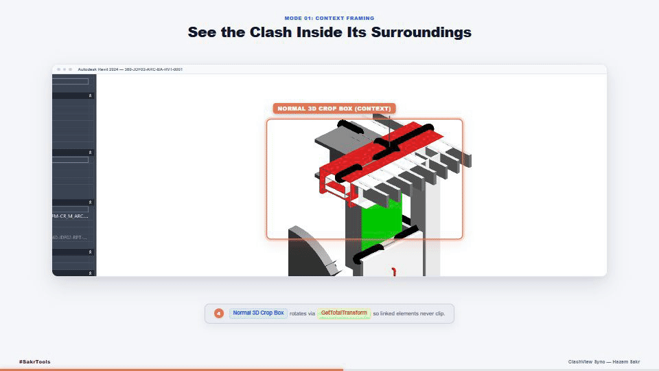

# ClashView Sync for Autodesk Revit

[](https://github.com/Hazemalisakr/ClashViewSync-pyRevit/actions/workflows/tests.yml)
[](https://www.autodesk.com/products/revit/overview)
[](https://github.com/eirannejad/pyRevit)
[](https://opensource.org/licenses/MIT)

**ClashView Sync** is a pyRevit extension that bridges the gap between Autodesk Navisworks Manage and Autodesk Revit. It reads Navisworks Clash Detective XML exports, resolves clashing element IDs across host and linked models, computes 3D coordinate transformations, and automatically frames, isolates, and highlights the clash directly inside Revit.

---

## 🎬 Live Demo & Video Overview

<p align="center">
  
</p>

> 📺 **Full Presentation Video (32s Full HD @ 60 FPS):** [Watch / Download MP4](media/ClashViewSync_Widescreen_16x9.mp4) showcasing 1-Click XML ingestion, Navisworks Red/Green color parity, context framing, and zero-clutter isolation.

---

## The Problem

Resolving clashes between Navisworks and Revit is one of the most repetitive bottlenecks in BIM coordination:

1. **Manual ID Lookups**: BIM coordinators must copy Element IDs from Navisworks or PDF/HTML reports, switch to Revit, run *Select by ID*, and manually configure a 3D section box.
2. **Linked Model Coordinate Shifts**: Linked models frequently use shared coordinates, rotation, or elevation offsets. Revit's native section box operates in the host project's coordinate space, which often clips or completely misses rotated linked elements.
3. **Link Isolation Limitations**: Revit's native *Temporary Hide/Isolate* cannot isolate individual elements inside linked models without hiding the entire link.
4. **Project Browser Clutter**: Inspecting clashes often leads to dozens of temporary 3D views cluttering the Revit project.

---

## Key Capabilities

* **Navisworks XML Parser**: Parses Clash Detective XML reports, extracting clash test names, clash statuses, grid intersections, exact clash points, selection paths, and camera viewpoints. Supports metric and imperial project units.
* **Coordinate Transformation Engine**: Accounts for linked model transformations (`GetTotalTransform()`). Transforms all 8 corners of each element's local bounding box into host world coordinates, guaranteeing that section boxes accurately frame rotated or offset linked geometry.
* **Element Resolution Across Links**: Maps Navisworks selection paths to loaded Revit linked instances (`RevitLinkInstance`) and resolves 64-bit Element IDs in both host and linked documents.
* **Two Dedicated Framing Modes**:
  * **Normal 3D Crop Box**: Tight, padded section box framing the two clashing elements within their physical context.
  * **Isolated 3D Crop Box**: Full clash isolation. Automatically suppresses non-participating model categories, hides unrelated links, and hides interfering geometry inside the box so only the clashing items remain visible.
* **DirectContext3D Transient GPU Highlighting (Zero DB Writes)**: Renders clashing elements with vibrant Navisworks-standard colors directly through the graphics pipeline (`IDirectContext3DServer`):
  * **Item 1:** Translucent Red (`#DC1E1E`, 35% opacity)
  * **Item 2:** Translucent Green (`#00C800`, 35% opacity)
  * **100% Read-Only & Safe for Worksharing**: Creates **zero** `DirectShape` elements, zero proxies, and opens zero database transactions for graphics. Saving or syncing to central writes zero clash geometry.
  * **Hardware Section Box Clipping**: Viewport shaders automatically clip transient meshes against the active 3D section box.
  * **Automatic View Cleanup**: Highlighting clears automatically the instant the view is deactivated or closed.
* **Single View In-Place Switching**: Toggling between Normal and Isolated modes updates the view settings in place rather than creating duplicate views.
* **WPF Interface**: Clean UI with live clash search, clash test dropdown, view mode selection, and a persistent link to change XML reports on the fly.

---

## System Requirements & Compatibility

| Component | Requirement |
| :--- | :--- |
| **Autodesk Revit** | 2020, 2021, 2022, 2023, 2024, 2025, 2026 |
| **pyRevit** | 4.8.x or later (CPython 3 or IronPython) |
| **Navisworks** | Navisworks Manage 2018–2026 (Clash Detective XML report) |
| **Operating System** | Windows 10 / Windows 11 (64-bit) |

---

## Installation

### Method 1: Standalone Extension (Recommended)

1. Clone or download this repository as a `.zip` archive:
   ```bash
   git clone https://github.com/Hazemalisakr/ClashViewSync-pyRevit.git
   ```
2. Rename the extracted folder to `ClashViewSync.extension`.
3. Move `ClashViewSync.extension` to your pyRevit extensions folder:
   ```text
   %APPDATA%\pyRevit\Extensions\
   ```
4. In Revit, go to the **pyRevit** tab on the ribbon and click **Reload**.
5. The **Sakr Tools** tab will appear with the **ClashView Sync** tool.

### Method 2: Adding to an Existing `SakrTools.extension`

If you already use `SakrTools.extension`:
1. Copy `lib/clashview_sync/` and `lib/ClashViewSync.DirectContext.dll` into your existing `SakrTools.extension/lib/`.
2. Copy `Sakr Tools.tab/Tools.panel/ClashView Sync.pushbutton/` into your existing `SakrTools.extension/Sakr Tools.tab/Tools.panel/`.
3. Add `ClashView Sync` to the `layout:` list in `Sakr Tools.tab/Tools.panel/bundle.yaml`.
4. Click **pyRevit > Reload**.

---

## Workflow

```
┌─────────────────────────────────┐
│       Navisworks Manage         │
│  Run Clash Detective Analysis   │
│  Export Report as XML           │
└────────────────┬────────────────┘
                 │
                 ▼
┌─────────────────────────────────┐
│     Revit: ClashView Sync       │
│  1. Load XML Report             │
│  2. Select Test & Clash Name    │
│  3. Pick Framing Mode           │
└────────────────┬────────────────┘
                 │
        ┌────────┴────────┐
        ▼                 ▼
 ┌───────────────┐ ┌───────────────┐
 │ Normal Mode   │ │ Isolated Mode │
 │ Context-aware │ │ Zero-clutter  │
 │ 3D crop box   │ │ clash view    │
 └───────────────┘ └───────────────┘
```

1. **Export from Navisworks**: Open Clash Detective > Report tab > select **XML** format > click **Write Report**.
2. **Launch in Revit**: Click **Sakr Tools > ClashView Sync**.
3. **Select Clash**: Choose the clash test and specific clash from the dropdown.
4. **Choose Mode**:
   - Select **Normal 3D Crop Box** to review surrounding context.
   - Select **Isolated 3D Crop Box** to inspect only the clashing elements with surrounding distractions hidden.
5. **Switch Anytime**: You can switch modes on the same clash instantly without generating new views.

---

## Architecture & Codebase Structure

```
ClashViewSync-pyRevit/
├── .github/workflows/
│   └── tests.yml                 # Automated CI running on Python 3.9 - 3.12
├── extension.json                # pyRevit extension manifest
├── media/
│   ├── clashview_demo.gif        # Animated looping walkthrough for README & mobile
│   └── ClashViewSync_Widescreen_16x9.mp4 # 32s Full HD presentation video (<8.5 MB)
├── Sakr Tools.tab/
│   └── Tools.panel/
│       ├── bundle.yaml           # Panel layout configuration
│       └── ClashView Sync.pushbutton/
│           ├── bundle.yaml       # Pushbutton definition & tooltip
│           ├── icon.png          # 96x96 Ribbon icon
│           └── script.py         # WPF UI, user interaction, and Revit execution
├── lib/
│   ├── ClashViewSync.DirectContext.dll # Pre-compiled C# DirectContext3D assembly
│   └── clashview_sync/
│       ├── __init__.py           # Package exports
│       ├── models.py             # Data structures (ClashResultItem, CameraViewpoint, etc.)
│       ├── xml_parser.py         # Navisworks XML parsing & unit conversion
│       ├── coordinate_transformer.py # 8-corner bounding box math & transformation
│       ├── element_resolver.py   # Multi-document element resolution & disambiguation
│       └── view_builder.py       # Revit View3D generation, section box, and graphic overrides
├── src/
│   └── ClashHighlighter.cs       # C# source for DirectContext3D external server
├── sample_data/
│   └── sample_clash_report.xml   # Sample XML report for verification
└── tests/
    ├── run_all_tests.py          # Master test runner (66 tests)
    ├── test_models.py
    ├── test_coordinate_transformer.py
    ├── test_xml_parser.py
    ├── test_element_resolver.py
    └── test_view_builder.py
```

---

## Running Unit Tests

The test suite runs independently of the Revit process using mocks for Revit API / pyRevit dependencies:

```bash
python -B tests/run_all_tests.py
```

Test coverage includes:
- Mathematical accuracy of 8-corner bounding box transformations across rotations and mirror matrices.
- Navisworks XML parsing with edge cases (nested groups, UTF-8 BOM, missing IDs, dynamic units).
- Element resolution with selection tree disambiguation across multiple link instances.
- Graphic overrides and view reuse guarantees (ensuring zero view duplication).

---

## Author

**Hazem Sakr**  
BIM Automation & Computational Design  
[LinkedIn Profile](https://www.linkedin.com/in/hazem-sakr/)

---

## License

This project is licensed under the [MIT License](LICENSE).
